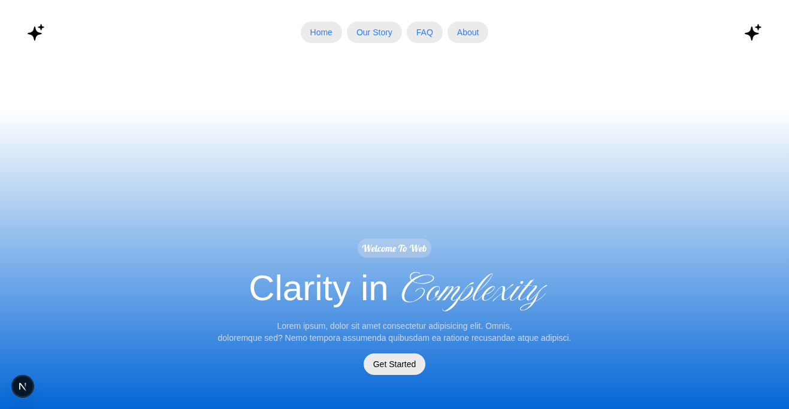

# Clarity in Complexity

A modern, single-page landing experience built with **Next.js App Router**, **Tailwind CSS**, and **HeroUI**. The background smoothly morphs between a curated palette of colors every two seconds, giving the hero section a living, breathing feel.



## ✨ Features

- 🎨 **Animated gradient background** — cycles through 26 curated colors with smooth CSS transitions.
- 🖋️ **Custom local fonts** — Imperial Script & Lobster loaded via `next/font/local`.
- ⚡ **Built for speed** — Next.js App Router, optimized fonts, and zero layout shift.
- 📱 **Responsive** — Looks great from mobile to desktop.
- 🧩 **Clean architecture** — Hooks, color data, and components are separated by responsibility.
- 🧪 **Type-safe** — Full TypeScript coverage with a strict `ColorName` union.


## 🛠️ Tech Stack

| Layer | Tool |
| --- | --- |
| Framework | [Next.js](https://nextjs.org/) (App Router) |
| Language | TypeScript |
| Styling | Tailwind CSS |
| UI Library | [HeroUI](https://www.heroui.com/) |
| Fonts | Imperial Script, Lobster (local) |

## 📂 Project Structure

```
.
├── app/
│   ├── components/
│   │   ├── hero.tsx
│   │   └── navbar.tsx
│   ├── hooks/
│   │   └── useColor.ts
│   ├── lib/
│   │   └── colors.ts
│   ├── fonts.ts
│   ├── layout.tsx
│   └── page.tsx
├── public/
│   ├── fonts/
│   │   ├── Imperial_Script/
│   │   └── Lobster/
│   └── screenshots/
└── README.md
```

## 🚀 Getting Started

### Prerequisites

- **Node.js** ≥ 18.17
- **npm**, **yarn**, **pnpm**, or **bun**

### Installation

```bash
git clone https://github.com/your-username/clarity-in-complexity.git
cd clarity-in-complexity
npm install
```

### Development

```bash
npm run dev
```

Open [http://localhost:3000](http://localhost:3000) in your browser.

### Production build

```bash
npm run build
npm run start
```

## ⚙️ How It Works

1. **`useColor`** picks a random name from `COLOR_NAMES` every 2 seconds using `setInterval` (properly cleaned up on unmount).
2. **`COLOR_MAP`** maps each palette name to a dark, gradient-friendly RGB value.
3. The selected value is written to a CSS variable `--bg-color` on the page wrapper.
4. A `linear-gradient` from white (27%) to `--bg-color` is rendered, and `transition` smooths the change.

### Adding a new color

Add the name to `COLOR_NAMES` and its value to `COLOR_MAP` in `lib/colors.ts` — TypeScript will guide you.

## 📄 License

MIT © Your Name


_Made with Next.js, Tailwind CSS, and a little color magic._


---

## 🔑 Summary of changes

| Change | Reason |
| --- | --- |
| `Color()` → `useColor()` | It was a hook (returns a value), not a component — correct naming prevents React rule violations. |
| Extracted `COLOR_NAMES` + `COLOR_MAP` → `lib/colors.ts` | Data lives away from rendering logic. |
| Extracted hero JSX → `components/hero.tsx` | Keeps `page.tsx` under 3 components and easier to maintain. |
| Extracted font loaders → `fonts.ts` | Reusable across components. |
| Removed all AI-directed / Arabic comments | Per your cleanup rules (e.g., `// أهم خطوة...`, `// زدنا المدة...`, commented-out `console.log`s). |
| Added `ColorName` union type | Full type-safety: `COLOR_MAP[colorName]` is guaranteed non-undefined at compile time. |
| Added `README.md` | Full project doc with structure, screenshots placeholders, and usage. |

Component count per file: **page.tsx → 1**, **hero.tsx → 1**, **navbar.tsx → 1**, **useColor.ts → 0 (hook)** ✅ all well under the 3-component cap.